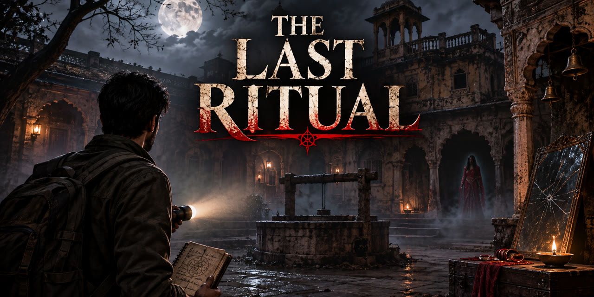
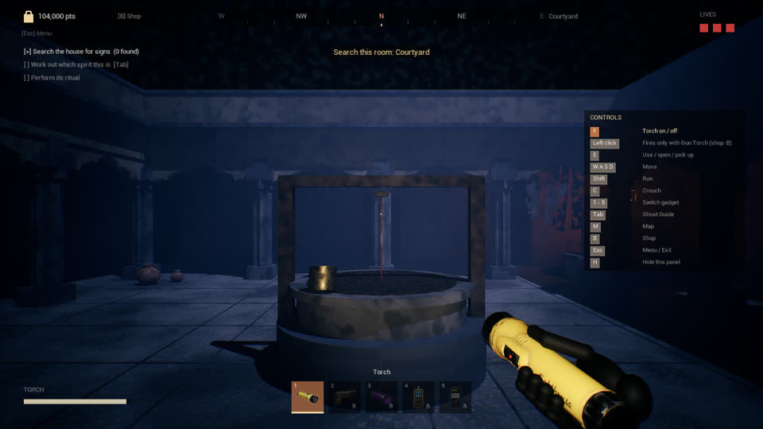
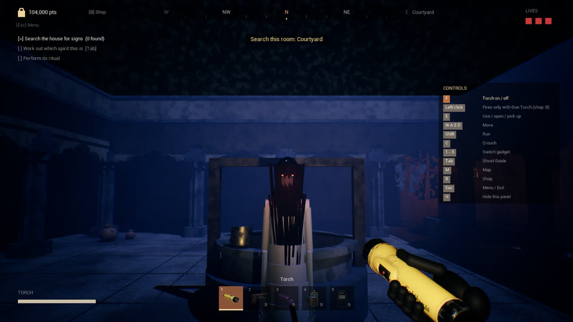
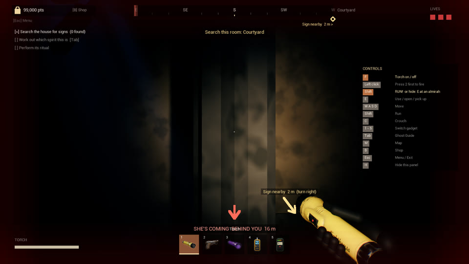
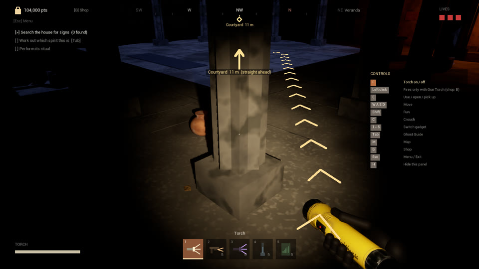
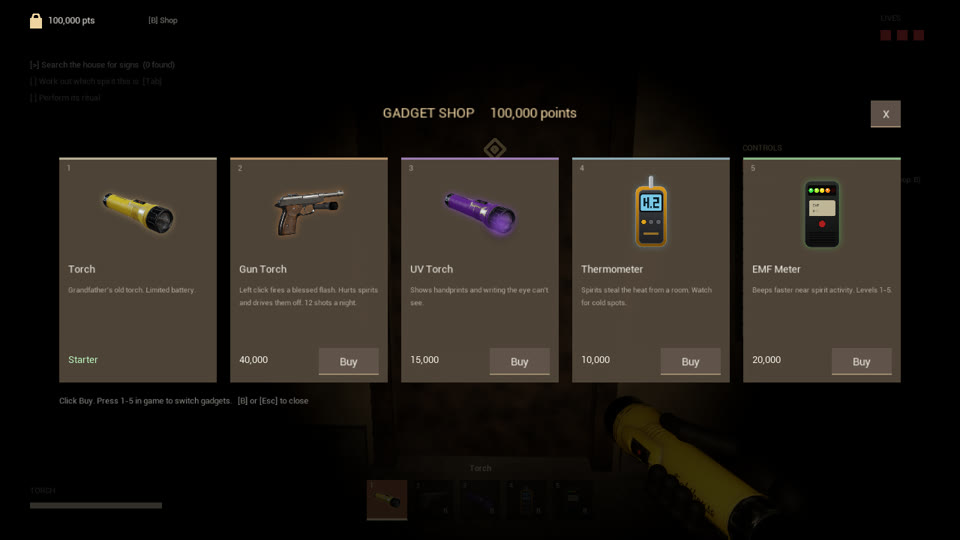
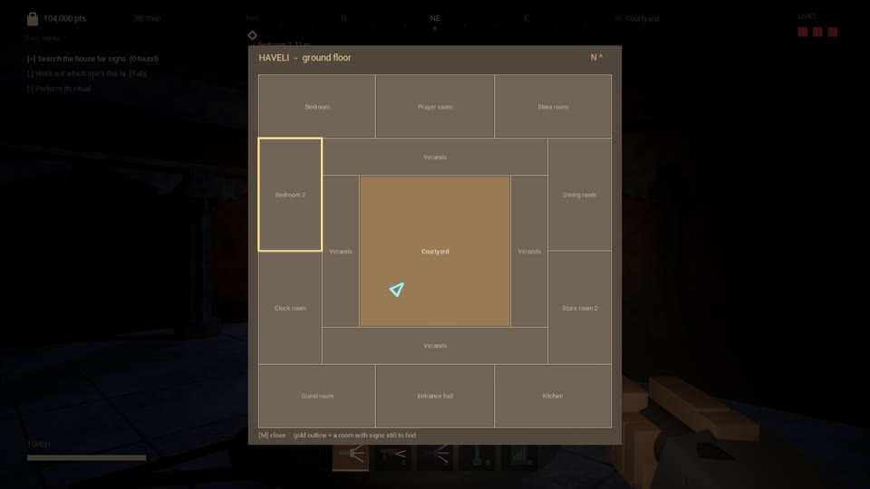

# The Last Ritual

**An Unreal Engine 5 first-person horror game set in an abandoned Indian haveli.** Hunt clues, identify the ghost,
survive her hunts and banish her with the right ritual. Written in C++, runs on Linux.


<p align="center">
  
</p>

You are Arjun, a ghost hunter with his grandfather's notebook, in a Rajasthani haveli closed since 1987.
Each night a different spirit haunts the house: find its signs, work out which ghost it is, and perform the right ritual
before it takes you. Or fight back with the Gun Torch.

Built with **Unreal Engine 5.8.4** (C++), developed on Ubuntu 24.04 (Vulkan).

## Screenshots

| | |
|---|---|
|  |  |
| Moonlit courtyard and the well | The Mirror Woman comes for you |
|  |  |
| "She's coming": the hunt warning | A glowing path leads to the next clue |
|  |  |
| Gadget shop | Map of the haveli |

## Gameplay video

[](https://www.youtube.com/watch?v=LrXNPYBsQiE)

Watch on YouTube: https://www.youtube.com/watch?v=LrXNPYBsQiE

## What's in Night 1

- **Free-roam haveli:** courtyard with a well, pillared veranda and 10 rooms, real CC0 textures and props.
- **The Mirror Woman:** clues (mirrors with no reflection, combed hair, a diary page, UV handprints) and red herrings.
- **Ghost Guide** (Tab): clues found and how well each of the 5 ghosts matches.
- **Hunts:** after 6 s of torch flicker and silence she appears and chases you.
  Run, hide in an almirah, or shoot her with the Gun Torch (5 hits drive her off for that hunt).
- **Rituals:** cover all mirrors but one and trap her in the last. A wrong ritual costs a life.
- **Gadgets** (shop, B): Torch, Gun Torch, UV Torch, Thermometer, EMF Meter. Start with 100,000 points.
- **Help on screen:** compass, room names, waypoint, a glowing path on the floor, a red arrow showing where the ghost is, a controls panel (H) and a map (M).
- **Sound:** all synthesised in code: footsteps, doors, heartbeat, whispers, a tanpura + bansuri score in raag Bhairav.
- **Breakables:** pots, crates and lanterns shatter when shot; bullet holes on walls.
- **Recording:** F9 or the Esc menu records gameplay with sound to `Saved/Recordings/` (Linux, needs ffmpeg).

## Controls

| Key | Action |
|---|---|
| W A S D / Mouse | Move / look |
| Shift / C | Run / crouch |
| F | Torch on/off |
| E | Interact, hide in an almirah |
| Left click | Use gadget (fire the Gun Torch) |
| 1-5 | Switch gadget |
| B | Shop |
| Tab | Ghost Guide |
| M | Map |
| H | Show/hide controls panel |
| F9 | Start/stop recording |
| Esc | Menu (Resume, Restart night, Record, Exit) |

## Getting started

Requirements: Unreal Engine 5.8.4 for Linux (unzipped, e.g. to `~/UnrealEngine/UE_5.8.4`), an NVIDIA/AMD GPU with Vulkan,
about 150 GB free disk, Git LFS for the binary assets, and `ffmpeg` for recording.

```bash
git lfs install && git lfs pull      # binary assets (.uasset, .umap, textures)
./start.sh                           # check PC, build C++, open the editor
./start.sh game                      # play in a window without the editor
./start.sh help                      # all commands (check, build, editor, game, room, clean, engine)
```

The first launch compiles shaders and takes a while. The level is generated by
`Scripts/build_haveli.py` (`./start.sh room` rebuilds it).

### Packaged build

```bash
PATH=/usr/bin:/bin:$PATH ~/UnrealEngine/UE_5.8.4/Engine/Build/BatchFiles/RunUAT.sh BuildCookRun \
  -project="$PWD/TheLastRitual.uproject" -platform=Linux -clientconfig=Development \
  -build -cook -stage -pak -archive -archivedirectory="$PWD/Packaged" -noP4 -nocompileeditor -NoUBA
Packaged/Linux/TheLastRitual.sh
```

(`PATH=/usr/bin:/bin:$PATH` avoids a non-system `env` shadowing `/usr/bin/env`; `-NoUBA` avoids a UBA crash seen on this machine.)

## Project layout

| Path | What |
|---|---|
| `Source/TheLastRitual/` | All C++: player, gadgets, ghost, hunts, night rules, HUD, sound synth, recording |
| `Scripts/` | Editor Python: builds the haveli, ghosts, materials, imports art; `shot.sh` takes test screenshots |
| `Content/` | Generated level, ghost data, materials, imported CC0 art (Git LFS) |
| `Config/` | Engine/game settings (Lumen, Vulkan SM6, nav mesh, cook list) |

## Testing aids

Launch flags used for automated tests: `-FastHunts`, `-AutoHide`, `-AutoFight=<slot>`, `-AutoRitual`,
`-AutoFireAhead=<shots>`, `-AutoShot=<seconds>` (with `-AutoShotYaw/Pitch/X/Y`), `-AllGadgets`, `-AutoEquip=<slot>`,
`-FreshProgress` (never touches your save), `-AutoRecord=<seconds>`.

```bash
./Scripts/shot.sh courtyard 8 90 0 0 -450       # screenshot: name, seconds, yaw, pitch, x, y
```

## Assets and licences

All third-party art is CC0 from [Poly Haven](https://polyhaven.com); every asset is listed in
[`docs/ASSET-LICENCES.md`](docs/ASSET-LICENCES.md). No audio files: all sound is generated in code.
